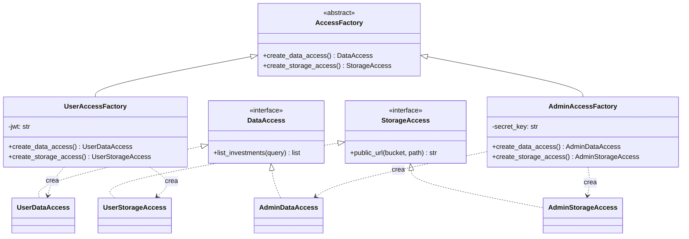
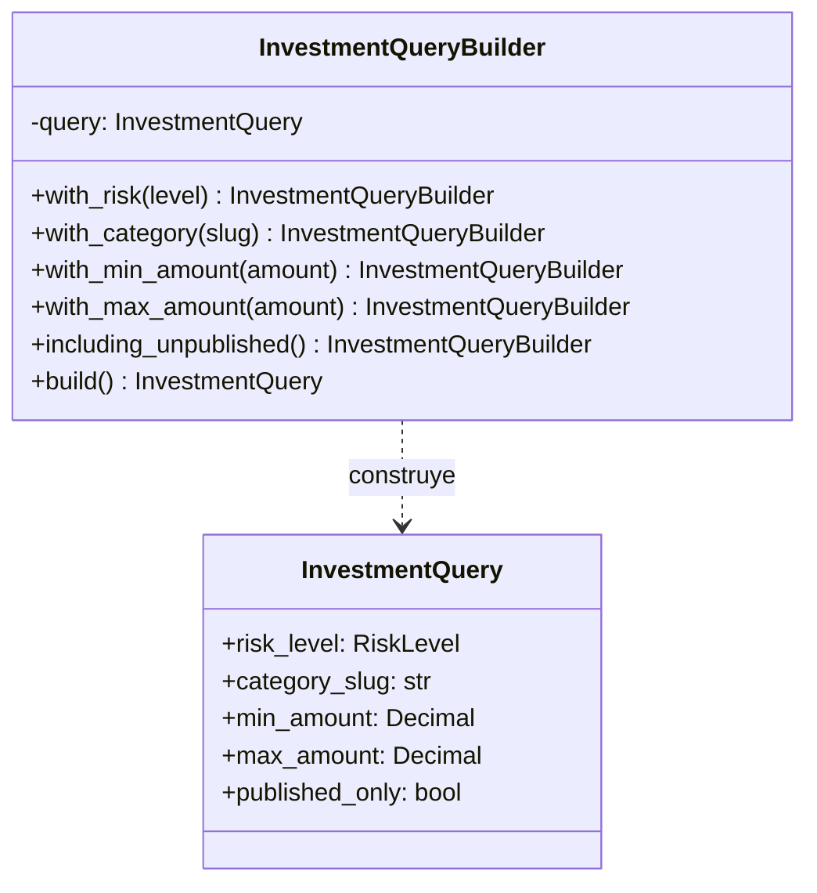
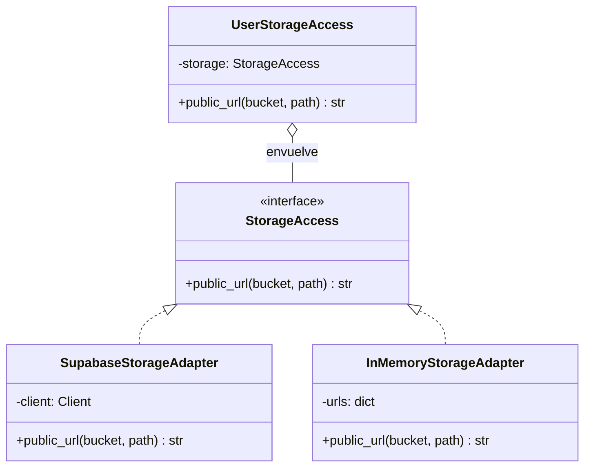
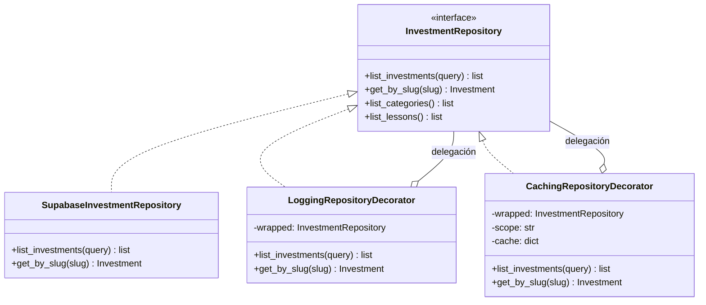
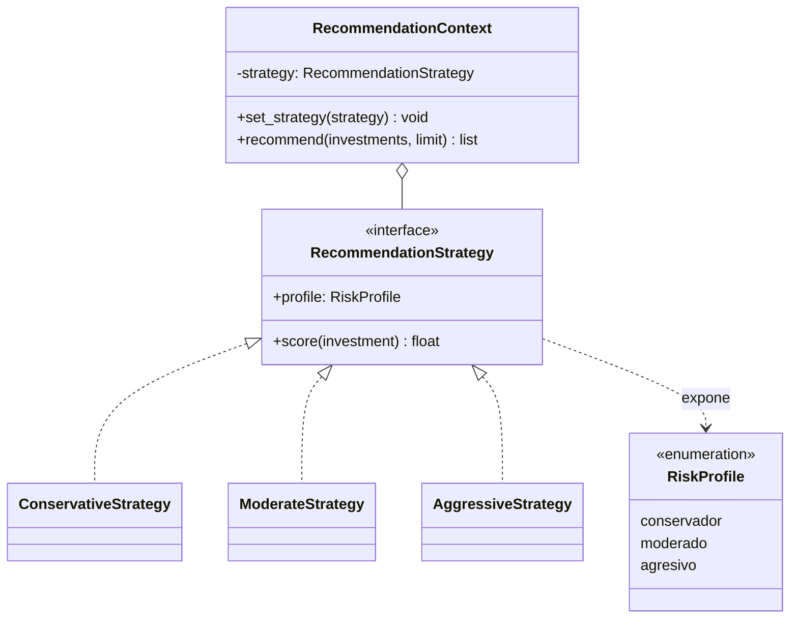
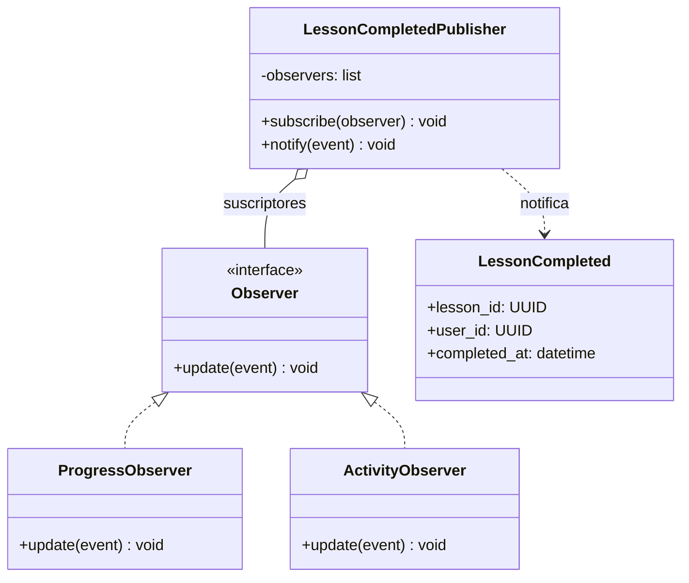

# Diagramas UML de los patrones GoF

Los diagramas están en Mermaid y se renderizan directamente en GitHub. Cada sección corresponde a un patrón implementado en `apps/api/src/velmora/patterns/` y verificado en `apps/api/tests/test_patterns.py`.

## Abstract Factory (creacional)

La fábrica de usuario propaga el JWT del solicitante a PostgREST, por lo que RLS se evalúa con su identidad. La fábrica administrativa exige la clave secreta del servidor y no puede ser seleccionada por el cliente.

## Builder (creacional)

El builder valida que los montos no sean negativos y que el mínimo no supere el máximo. `InvestmentQuery` es inmutable: cada paso usa `model_copy(update=...)`.

## Adapter (estructural)

El adaptador normaliza la API de Storage de Supabase frente a una interfaz simple, permite sustituirla por una implementación en memoria en tests y evita acoplar el servicio al SDK.

## Decorator (estructural)

La composición se realiza en `decorate(repository, scope, cache=...)`. El repositorio base permanece intacto; los decoradores añaden trazas y caché por ámbito/petición.

## Strategy (comportamiento)

`InvestmentService` cambia la estrategia según `RiskProfile` y devuelve recomendaciones con motivos textuales; no estima ni promete rentabilidad.

## Observer (comportamiento)

Al completar una lección, `ProgressService` publica `LessonCompleted`; el observador de progreso persiste el avance y el de actividad registra el evento, sin que el servicio conozca sus implementaciones.
